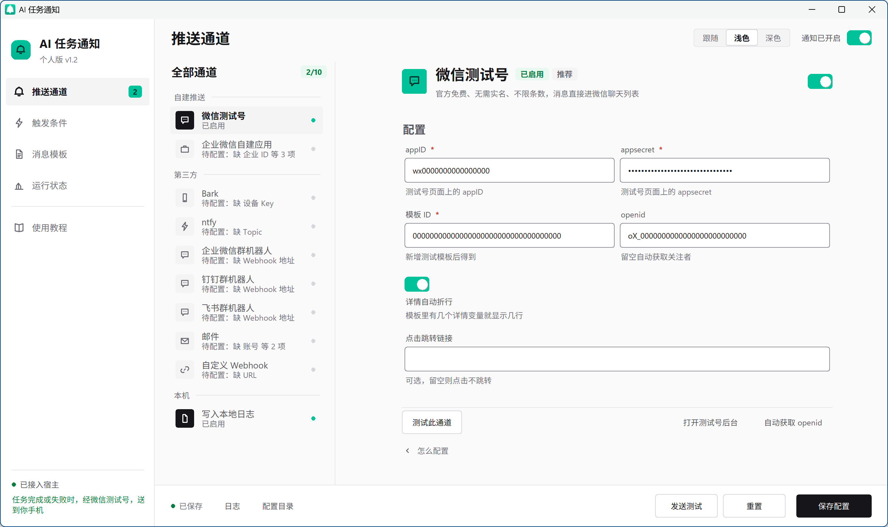
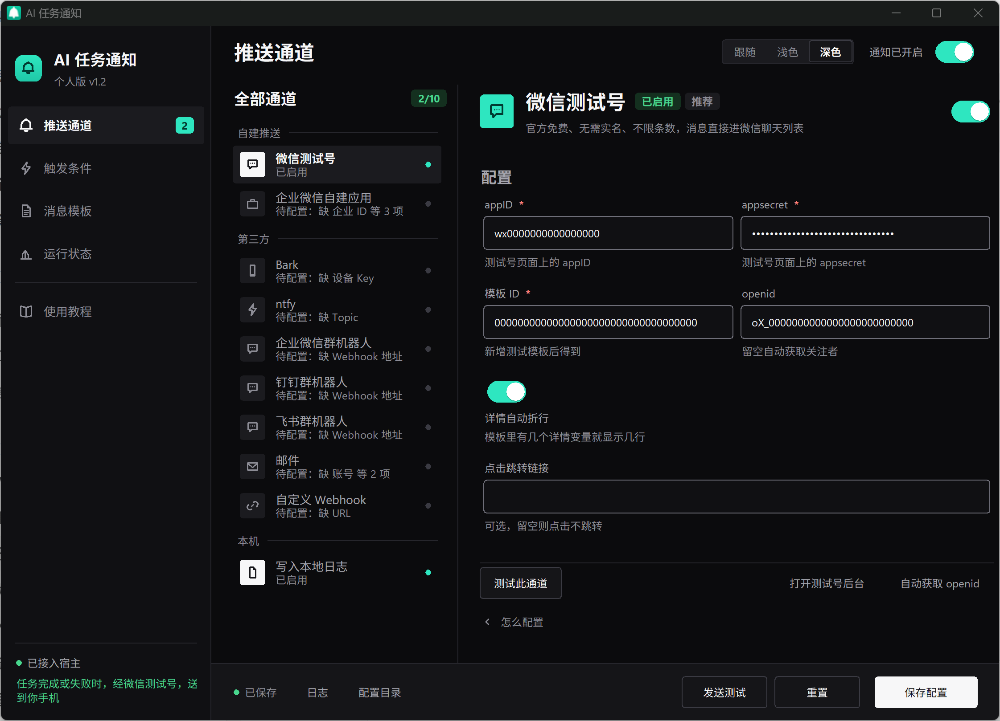
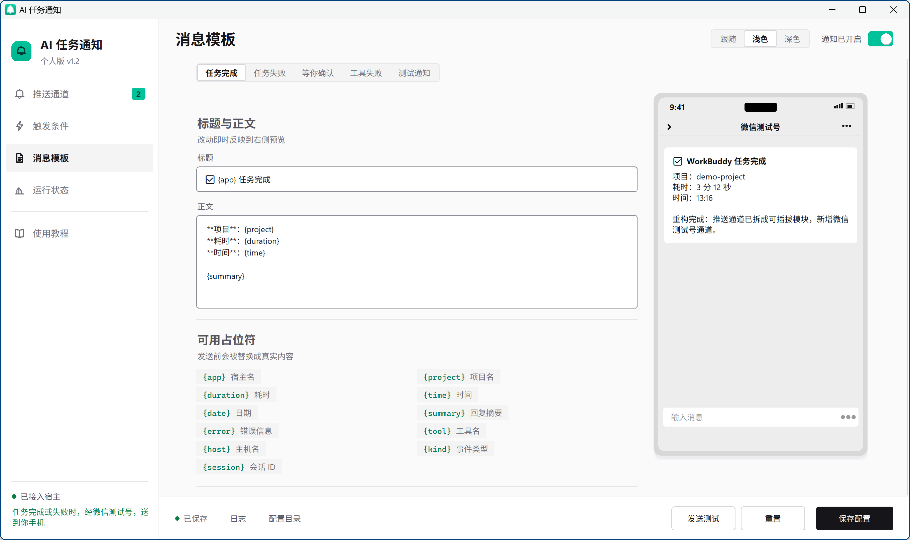
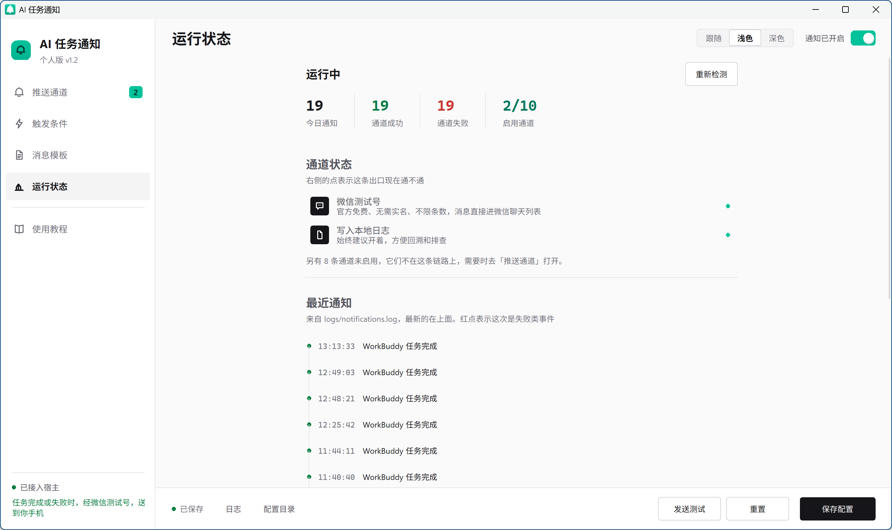
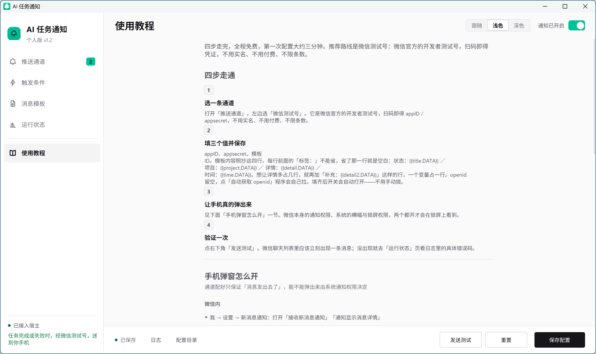

# AI 任务通知

[](https://github.com/xinghanyumai/ai-task-notify/actions/workflows/ci.yml)


任务一停就推到手机，**每条通知都能在本地查到发没发出去**。

WorkBuddy / CodeBuddy 跑完一轮、失败、或者停下来等你确认的时候，把结果推到手机。

Windows 10 / 11 · 个人自用 · 零服务器 · 零订阅费 · 零实名

在聊天窗口里等 agent 干活的体验不太好：它跑完了你不知道，它问你要权限你也没看见。
这个工具挂在宿主的 hooks 上，任务一停就把结果发到微信、企业微信、Bark 或 ntfy。
通知链路只用 Python 标准库；设置界面要 `pywebview`，托盘要 `pystray` + `Pillow`，缺了照样收通知。

<p align="center">
  
  
</p>
<p align="center">
  
  
  
</p>
<p align="center">
  <sub>推送通道（浅色 / 深色） · 消息模板 · 运行状态 · 使用教程</sub>
</p>

## 它解决什么

挂在 AI 编程助手的 hooks 上，任务一停就把结果推到手机。不改宿主代码，不装插件，不依赖宿主的私有目录。

现成方案解决的是「**怎么把一句话送到我手机上**」；本项目解决的是「**哪些事该发、发什么、发过没有、发失败了算谁的**」。

| 维度 | 只有推送脚本时 | 本项目 |
|---|---|---|
| 事件 | 一个 `push(text)`，发不发靠 prompt 里写 | 6 类事件各有模板与开关（`wbn/events.py` 的 `classify()`；`config.example.json` 的 `triggers` / `titles` / `templates`） |
| 去重 | 无 | 终态事件按「哪个会话的第几轮」去重，非终态按内容（`wbn/pipeline.py` 的 `_dedup_key()`） |
| 静默 / 限流 | 无 | 静默时段 + 每分钟 4 条 / 每小时 20 条（`wbn/filters.py` 的 `check()`） |
| 投递结果 | 不知道发没发出去 | 每次投递落一行 `ok=True/False`（`wbn/channels.py` 的 `send_all()` → `logs/notify-*.log`） |
| 宿主 | 只服务一个 | WorkBuddy / CodeBuddy / 旧版目录三处都认（`install.py:69-72`） |

**代价，先说清楚：**

- 只支持**已经装好 hooks 机制**的宿主。宿主不发 hook，本项目收不到任何东西。
- 通知延迟取决于宿主：源码形态约 70ms；**单文件 exe 形态每次要自解压，1.5–2.2 秒**，一条通知端到端约 3–4.5 秒。对「任务完成提醒」无感，对「毫秒级告警」不合适。
- 10 个通道里只有 3 个在真实环境验证过，见下面的[支持矩阵](#支持矩阵)。

## 为什么不是一堆推送脚本

一句话：推送脚本解决「怎么发」，本项目解决「什么时候发、发过没有、发失败了算谁的」。下面每条都能在仓库里找到对应实现，不是设计意图。

- **事件有语义，不是一个 `push(text)`。** 6 类事件（任务完成 / 失败 / 等你确认 / 工具失败 /
  会话开始 / 结束）各有标题模板、内容模板和独立开关，改标题不用改代码，改 `config.json` 就行。
  依据：`config.example.json` 的 `triggers` 6 项、`titles` 与 `templates` 各 7 个键（6 个事件 + `test`），
  归类在 `wbn/events.py` 的 `classify()`。
- **终态事件按事件身份去重。** 同一个 turn 里宿主连发 3 次 `TaskCompleted`，你只收到 1 条；
  非终态（等你确认、工具失败）按内容去重，连按 3 次仍然收 3 条。
  依据：`wbn/pipeline.py` 的 `_dedup_key()` + `tests/test_dedup_turn.py`。
- **静默时段 + 频率上限。** `quiet_hours` + 每分钟 4 条 / 每小时 20 条，外加「工具连续失败 3 次才报」
  （`tool_fail_threshold`），避免一个坏命令刷你 40 条。
  依据：`config.example.json` 的 `filters`；判定顺序在 `wbn/filters.py` 的 `check()`。
- **每次投递都留证据。** 一条通知落一行 `channel=wxmp ok=True msg=已送达微信`，失败落 `ok=False` +
  服务端返回原文。状态页直接读这些行，不是猜的。依据：`logs/notify-*.log` 的投递流水，
  截至 2026-10-30 本仓库自己已真实投递 **480+ 次**，结果见下面的[支持矩阵](#支持矩阵)。
- **不读宿主的私有目录。** 只用公开的 hooks 协议（`settings.json` 的 `hooks` 字段）。
  依据：`install.py:69-72` 只写三个 `settings.json`，不读 `claw-state/`。宿主改内部结构，本项目不断。

### 什么情况下别装本项目

- 只是想让任务结果出现在微信里 → 装 `wechat-clawbot-push` 就够，**不用装本项目**（详见下面「已经有官方通知」那节）
- 要毫秒级告警 → exe 形态端到端 3–4.5 秒，不合适
- 不是 Windows → 本项目是 Windows 专有实现（DWM 标题栏、`icacls`、`WebView2`），不跨平台
- 宿主不发 hooks → 收不到任何东西，装也没用
- 不想在机器上装 Python → 可以用 exe，但每次 hook 要多等约 2 秒（R54）

## 支持矩阵

内置 10 个通道，可以同时开多个，任一成功即视为送达。默认只开「本地日志」，它只写文件不打扰你。

| 通道 | 费用 / 实名 | 真实投递验证 | 到达方式 |
|---|---|---|---|
| 微信测试号 `wxmp` | 免费不限条 / 不要 | ✅ **100+ 次成功**（另有 128 次失败，见下） | 微信聊天列表 |
| 本地日志 `log` | 免费 / — | ✅ 250+ 次 | 文件 |
| 自定义 Webhook `webhook` | 免费 / — | ✅ 2 次（本地服务） | 你自己的服务 |
| 企业微信自建应用 `wecom_app` | 免费不限条 / 不要 | ⚠️ **未验证** | 企业微信 / 微信插件 |
| 企业微信群机器人 `wecom_bot` | 免费 / 不要 | ⚠️ **未验证** | 企业微信 |
| 钉钉机器人 `dingtalk_bot` | 免费 / 不要 | ⚠️ **未验证** | 钉钉 |
| 飞书机器人 `feishu_bot` | 免费 / 不要 | ⚠️ **未验证** | 飞书 |
| Bark `bark` | 免费可自建 / 不要 | ⚠️ **未验证** | iOS 通知中心 |
| ntfy `ntfy` | 免费可自建 / 不要 | ⚠️ **未验证** | App 推送 |
| 邮件 `smtp` | 免费 / 不要 | ⚠️ **未验证** | 手机邮件 App |

> **「未验证」的意思是**：代码写完了、字段名按官方文档填的、错误处理写了，但**没有用真实凭证跑通过**。
> 第一次配的时候如果报错，先按 [docs/channels/](docs/channels/) 核对字段，再看日志里的
> `ok=False msg=…`——那行是服务端返回的原文。

> **`wxmp` 那 128 次失败全部发生在 2026-10-26 至 10-29**，根因是模板变量前缺「标签：」导致正文渲染为空
> 而接口仍返回 `errcode: 0`。修复后 10-30 单日 **100+ 次投递全部成功**。这条留在这里是因为它比
> 「已稳定运行」更能说明这个通道被真正用过。

> 上面的数字是 2026-10-30 的实测值。当天 `notify-2026-10-29.log` / `-10-30.log` 被一次测试造数
> 误覆盖，原始流水已归档到 `tmp/logs-corrupted/`（不在仓库内），所以现在重跑统计脚本会得到更小的数——
> 那是证据被移走，不是数字写错。

## 通知长什么样

下面是 `selftest.py --dry` 的真实输出，标题和正文都是模板渲染结果，不是示意：

```text
── 场景 task_done  (hook 事件 Stop → 语义 task_done)
   标题: ✅ WorkBuddy 任务完成
   │ **项目**：Work buddy 通知
   │ **耗时**：42 秒
   │ **时间**：19:57
   │ 
   │ 已完成通知程序开发：包含 hook 入口、异步派发、10 个推送通道、配置界面与桌面快捷方式。

── 场景 need_input  (hook 事件 PermissionRequest → 语义 need_input)
   标题: 🙋 WorkBuddy 等你确认
   │ **项目**：Work buddy 通知
   │ **提示**：需要你确认是否允许执行 rm -rf build/
   │ **时间**：19:57
```

## 快速开始

### 1. 建环境

需要 Windows 10/11 和 Python 3.10 以上（开发机上实测 3.13.5）。在项目目录里执行：

```bash
python -m venv .venv
.venv\Scripts\python.exe -m pip install -r requirements.txt
```

`requirements.txt` 里运行时是三个包：`pywebview` 负责设置界面（依赖系统 WebView2），
`pystray` + `Pillow` 负责托盘图标。**三个都不影响通知链路**——`hook.py` / `dispatch.py` /
`wbn/` 只用 Python 标准库，缺任何一个都能正常收通知，只是少了界面或托盘。
（文件末尾还有一个 `windows-capture`，只给开发期的截图脚本用，运行程序不需要，也不进 exe。）

### 2. 挂上 hooks

```bash
.venv\Scripts\python.exe install.py all
```

这一步做三件事：往 WorkBuddy 和 CodeBuddy 的 `settings.json` 里各写 9 个事件的 hook、
建桌面快捷方式、建开机自启项。安装器是幂等的，重复执行只替换自己的条目，
改 `settings.json` 之前会自动备份成 `settings.json.bak-时间戳`。
想看看当前状态用 `install.py status`，想撤掉用 `install.py uninstall`。

> 快捷方式指向执行 `install.py` 的那个解释器，所以上面用 `.venv\Scripts\python.exe`
> 而不是裸 `python`。装到别的解释器里，快捷方式就会指向那个解释器。

### 3. 配一个手机通道

双击桌面的「AI 任务通知」，进「推送通道」页。左侧是通道清单，绿点表示已启用，
点任意一项在右侧填参数，填完点右下角「测试此通道」，手机应该立刻响。

微信测试号是最省事的一条路，扫码两分钟，免费免实名，消息直接进微信聊天列表。
完整步骤和三个容易踩的坑在 [docs/channels/wechat-sandbox.md](docs/channels/wechat-sandbox.md)。

### 4. 重启宿主

**hooks 配置在宿主启动时读取并缓存，改完必须完全退出重启。**

WorkBuddy 点窗口关闭按钮只是隐藏到托盘，要右键托盘图标选「退出」，
或者用任务管理器结束 `WorkBuddyAI.exe`。CodeBuddy 完全关掉再打开。

重启后跑一个 20 秒以上的任务，手机会收到通知。

### 5. 验证

```bash
.venv\Scripts\python.exe selftest.py            # 真实发送 4 类通知
.venv\Scripts\python.exe selftest.py --dry      # 只渲染，不发送
.venv\Scripts\python.exe selftest.py --status   # 看 hooks 挂载状态
```

`selftest.py` 不经过 stdin，所以它发得出去不代表真实事件也发得出去。
端到端只有一个验证方法：在 WorkBuddy 里跑一个长任务，然后看手机。
测试消息收得到、真实任务一条都没有的话，看 [docs/troubleshooting.md](docs/troubleshooting.md)。

## 打成单文件 exe（可选）

不想在目标机器上装 Python，就打包一个 exe 拷过去：

```bash
.venv\Scripts\python.exe -m pip install pyinstaller
.venv\Scripts\python.exe tools\build_exe.py
```

产物是**项目根目录的 `通知.exe`**（约 19MB，一个文件）。`build_exe.py` 会在打包前后做七道
核对：产物形态（根目录有 exe、没有 `通知/` 目录、体积 18–26MB）、五个子命令模块在不在包里、
pywebview 的注入脚本在不在、`webui/` 文件数源码 == exe、`--version` 冒烟。
**任何一道红都别绕过**——它们挡的是「exe 能启动但一件正事都干不了」那类问题，本机测不出来。

**交付只发根目录的 `通知.exe`，别把整个项目文件夹发出去。** 它和源码模式共用同一份
`config.json` / `logs\` / `state\`——里面是你本机的微信 appid / appsecret / openid
和全部通知记录，带出去等于把配置一起发出去。

```bash
通知.exe                 # 开设置窗口（双击就是这个）
通知.exe install         # 挂 hooks + 建快捷方式
通知.exe uninstall       # 撤掉
通知.exe tray --silent   # 托盘常驻
通知.exe --version       # 版本号
```

配置和日志写在 **exe 旁边**，也就是项目根目录（`config.json` / `logs/` / `state/`）。
这和源码模式是**同一份**——在界面里改完，两边看到的一致。放在 `C:\Program Files`
这种写不进去的目录时，自动回落到 `%LOCALAPPDATA%\WBNotify\`——状态页会显示实际用的路径。

排查问题用调试版（带控制台，能看见 traceback）：

```bash
set WBN_CONSOLE=1 && .venv\Scripts\python.exe -m PyInstaller --noconfirm --distpath . notify.spec
通知-debug.exe
```

## 选哪个通道

费用、到达方式和**真实投递验证状态**都在上面的[支持矩阵](#支持矩阵)里，按那三列挑就行。
每个通道的申请步骤、字段含义和各自的坑都在 [docs/channels/](docs/channels/)；为什么主推
微信测试号而不是第三方推送平台，见 [ADR-003](docs/adr/ADR-003-wechat-sandbox-over-push-platforms.md)。

## 已经有官方通知 / MCP 推送了，还需要这个吗？

先说结论：**如果你只是想让任务结果出现在手机上，你可能不需要装本项目。**
市面上已经有几个能用的方案，其中「微信单通道」这件事本项目确实是重复建设。

### 别人已经有的

| 已有方案 | 覆盖什么 | 本项目的差异 |
|---|---|---|
| WorkBuddy 自带的桌面通知 | 电脑上弹窗 | 我们多一层「手机也能收」和「历史可查」 |
| `wechat-clawbot-push`（PyPI，MIT，MCP 连接器） | 任务结果 → 个人微信，复用已绑定的 ClawBot，不占名额 | 我们多 9 个通道、6 类事件模板、去重/静音、多宿主 |
| 企业微信群机器人 | 微信群/个人微信收消息 | 我们是同一个通道，但会按事件类型分模板 |
| `wexin-claw-hook`（Tauri 单 exe，本地 9720 webhook） | 任意脚本 curl 一行推微信 | 我们不要求宿主能发 HTTP |

**`wechat-clawbot-push` 在本机实测（2026-10-30）**：链路通（`--diag` 第 5 步
HTTP 200、4 个 IPv4 TLS 握手全 OK），但**照它的 README 逐字配置会失败**——
它把路径硬编码成 `~/.workbuddy/...`，而 WorkBuddy 当前实际用的是
`~/.workbuddy-ai/...`（`~/.workbuddy` 是 legacy 目录，本项目 `install.py` 里也是
这么标的）。后果是：MCP 注册进一个不会被读的文件、凭证**自动发现**失败、
`--diag` 直接建议你跑 `--login`。

但配置不用改它的源码，只要把两个值填进**它自己会读的那个** `config.json`：
`bot_token` 和 `user_id`（都在 `~/.workbuddy-ai/` 下面，只读不写）。
注意这两类路径的处理**不一样**：

| 放什么 | 路径 | 要不要加 `-ai` |
|---|---|---|
| MCP 注册 | `~/.workbuddy-ai/mcp.json` | **必须加**，不加就注册进一个不会被读的文件 |
| 凭证 | `~/.workbuddy/wechat-clawbot-push/config.json` | **不加**，包源码里硬编码就是这个路径 |

**绝不能跑 `--login`**——它会占掉微信侧唯一名额、顶掉 WorkBuddy 原生微信连接。

另外实测 `ret=-2` 的真正原因**不是**缺 `context_token`，是**没有「最近活跃会话」**：
你在微信里给 bot 发过一句话之后，**不携带 `context_token` 也能直接推成功**
（实测回执 `HTTP 200 发送成功（未携带 context_token，走最近活跃会话）`）；
没发过就是 `ret=-2`。所以「装好就能推」要补一个前提：**先让那个会话热起来**。

也别指望用 `--refresh` 去捞 `context_token`——WorkBuddy 同时运行时它**必然失败**
（两边用同一个 bot 抢同一条消息流，实测 `getupdates` 超时）。这也说明依赖
`context_token` 的路子本身不可靠，但**不影响推送**。

### 差异到底是什么

那些方案解决的是「**怎么把一句话送到我手机上**」；本项目解决的是
「**哪些事该发、发什么、发过没有、发失败了算谁的**」。
如果你只是想让任务结果出现在微信里，装 `wechat-clawbot-push` 就够，
**不用装本项目**。如果你要的是「六类事件分模板 + 十个通道任选 + 不依赖任何私有
目录」，再往下看。

### 本项目不依赖宿主的私有结构

这是唯一站得住的硬差异：本项目只读宿主**公开的 hooks 协议**——即
`~/.workbuddy-ai/settings.json` 里的 `hooks` 字段，那是宿主对外承诺的扩展点。
第三方 MCP 方案需要读 `~/.workbuddy-ai/claw-state/` 下的内部游标文件，那不是
公开 API，宿主一改内部结构就断。

顺带一句：本项目自己那条**微信测试号通道**也是保留的，不会因为上面这些方案存在
就标成「已废弃」——它不依赖任何私有目录，是宿主改内部结构后唯一还能活的微信出口。

## 常见问题

### 会不会拖慢我的对话

不会。hook 只做搬运，投递给后台进程之后立刻退出，本机实测约 70ms。
推送失败、通道超时、配置写坏都不会影响宿主，hook 永远 `exit 0`。

### 要不要一直开着托盘

不用。通知靠 hooks 按需唤起，托盘只是给你一个看状态和随手测试的入口，
它挂了不影响通知。

### 微信收到消息但正文是空的

模板里每个 `{{变量.DATA}}` 前面必须有「标签：」，否则那几行渲染为空，
而接口还返回 `errcode: 0`，看起来像成功了。跑 `selftest.py --wxmp` 会逐行告诉你
哪一行会空白、详情实际折成几行。

### 手机什么都没收到

先跑 `selftest.py`。测试消息能收到、真实任务没有，基本是宿主没重启，
或者撞上了中文编码那个坑，见 [docs/troubleshooting.md](docs/troubleshooting.md)。

### 日志里出现 `skip` 是出错了吗

不是。`skip` 是过滤链在正常工作——hook 跑了、链路是通的，只是这条按你的规则不该发。
真正坏了是**连 `skip` 都没有**。三步排查法（看 hook 跑没跑 → 看 `reason=` → 查宿主
那侧的 `hooks` 配置）在
[docs/troubleshooting.md](docs/troubleshooting.md) 的「某个宿主不通知，怎么查」。

### 那 7 个通道没验证过，为什么还留着

因为它们各自覆盖一种真实场景（iOS、安卓、已有企业微信、只收邮件），而通道实现是
配置驱动的：填错只会在日志里落一行 `ok=False`，不影响其它通道，也不影响宿主。留着
成本为零，删掉的成本是「想用时得重写一遍」。但**没验过就是没验过**，矩阵里一律标 ⚠️。

### 改了模板没反应

模板改动要点「保存配置」才落盘。

### 凭证会不会泄露

`config.json` 已进 `.gitignore`，程序每次保存后会用 `icacls` 把它的 ACL 收紧成
仅当前用户可读写，日志和错误信息统一走 `sanitize.redact()` 脱敏。
细节见 [docs/security.md](docs/security.md)。

## 文档

| 文档 | 内容 |
|---|---|
| [docs/architecture.md](docs/architecture.md) | hook 协议、事件归类、两段式架构、触发控制、fail-open |
| [docs/archive/design.md](docs/archive/design.md) | 📦 已归档：tkinter 时代的界面语汇、设计令牌、自绘控件 |
| [docs/security.md](docs/security.md) | 凭证处理、请求边界、不可信输入、截图脱敏 |
| [docs/troubleshooting.md](docs/troubleshooting.md) | 症状对照表、日志位置、编码事故完整复盘 |
| [docs/channels/](docs/channels/) | 10 个通道各一页，申请步骤与坑 |
| [docs/adr/](docs/adr/) | 7 条决策记录，写的是为什么这样选 |
| [docs/reviews/](docs/reviews/) | 2026-10-26 的开源就绪审查报告（01–04、07） |
| [SECURITY.md](SECURITY.md) | 怎么报安全问题、凭证泄露后的处置 |
| [CHANGELOG.md](CHANGELOG.md) | 变更历史 |

## 已知限制

微信测试号是「开发测试」定位，微信官方不承诺永久不变，接口调整了就先跑
`selftest.py --status` 确认，再换企业微信自建应用（同样免费免实名）。
详情最多四行、每行约 18 个汉字，因为微信卡片
一个变量只占一行。完整清单见 [docs/troubleshooting.md](docs/troubleshooting.md#已知限制)。

exe 形态另外三条：

- **每次 hook 事件要多等约 2 秒。** onefile 每次启动都要把 19MB 解压到
  `%TEMP%`。宿主的 hook 超时是 10–15 秒，不会超时，但 agent 的每次事件都被
  拖了一下。嫌慢就用源码形态（`python app.py install`），那条路径 ~70ms。
  实测口径（R54）：hook 单次 **1571–2259ms**，一条通知端到端 **3–4.5 秒**、写盘 **66MB**；
  exe 双击到窗口可交互中位数 **2549ms**（含自解压约 **970ms**），内存 private **381.3MB** /
  working set **578.2MB**。
- **WebView2 沙箱默认开着**，只在判定「窗口一片黑」时自动带 `--no-sandbox`
  重启一次。想强制带沙箱排查：`set WBN_WEBVIEW_SANDBOX=1`。
- **没在「没装 Python 的干净机器」上验过**（开发机只有一台）。本机能做到的
  最大程度是核对包内模块/文件清单 + 用 CDP 驱动五个页面全部渲染 + 打通
  hook→派发→通道全链路；目标机器缺 VC++ 运行库或 WebView2 运行时这类问题，
  只能到那台机器上才知道。

## 卸载

```bash
.venv\Scripts\python.exe install.py uninstall
```

移除两个 `settings.json` 里的 hooks，删掉桌面和开机自启快捷方式。
`config.json`、`logs/`、`state/` 留在项目目录，整个文件夹直接删掉也行。

## 许可

[MIT](LICENSE)
