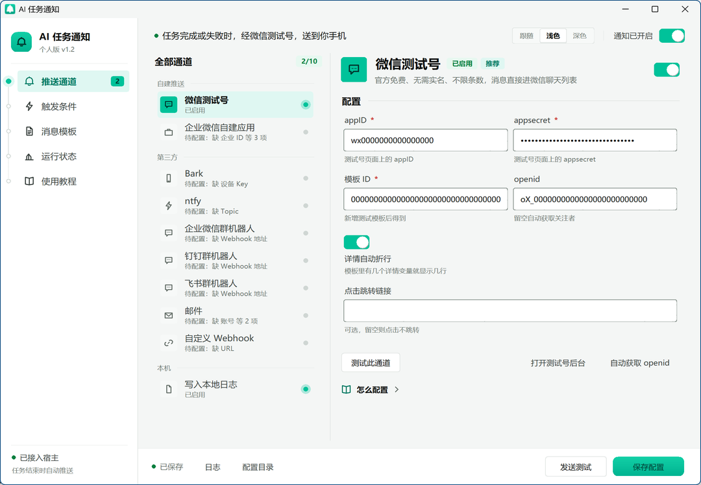
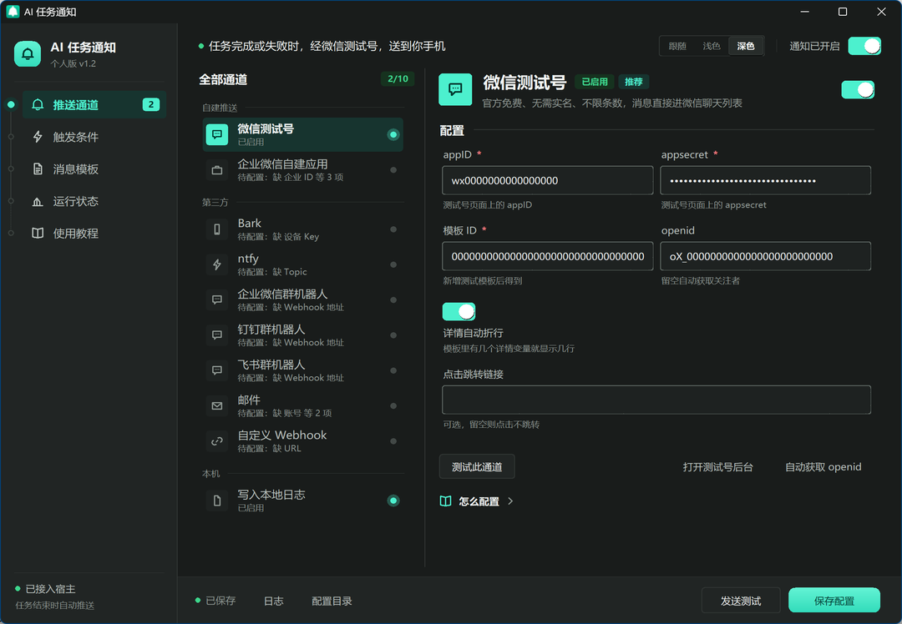
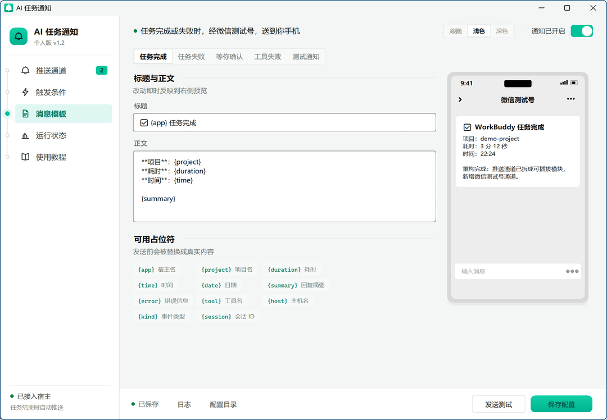
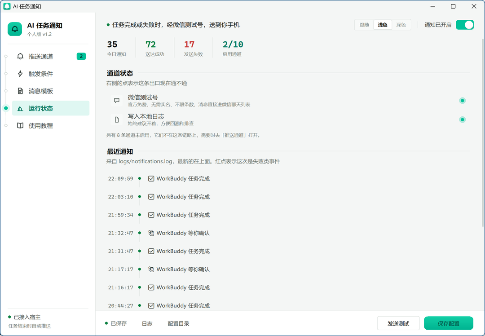
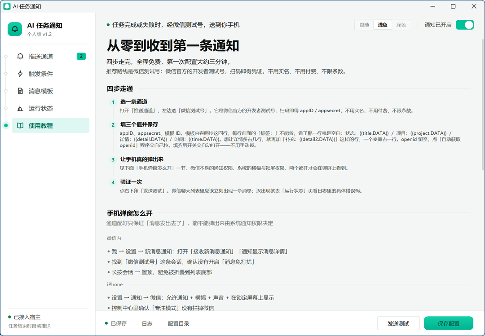

# AI 任务通知

WorkBuddy / CodeBuddy 跑完一轮、失败、或者停下来等你确认的时候，把结果推到手机。

Windows 10 / 11 · 个人自用 · 零服务器 · 零订阅费 · 零实名

在聊天窗口里等 agent 干活的体验不太好：它跑完了你不知道，它问你要权限你也没看见。
这个工具挂在宿主的 hooks 上，任务一停就把结果发到微信、企业微信、Bark 或 ntfy。
通知链路只用 Python 标准库，托盘那两个包缺了也能跑。

<p align="center">
  
  
</p>
<p align="center">
  
  
  
</p>
<p align="center">
  <sub>推送通道（浅色 / 深色） · 消息模板 · 运行状态 · 使用教程</sub>
</p>

## 快速开始

### 1. 建环境

需要 Windows 10/11 和 Python 3.10 以上（开发机上实测 3.13.5）。在项目目录里执行：

```bash
python -m venv .venv
.venv\Scripts\python.exe -m pip install -r requirements.txt
```

`requirements.txt` 里只有 `pystray` 和 `Pillow`，托盘图标要用。不装也能跑，只是没有托盘。

### 2. 挂上 hooks

```bash
.venv\Scripts\python.exe install.py all
```

这一步做三件事：往 WorkBuddy 和 CodeBuddy 的 `settings.json` 里各写 9 个事件的 hook、
建桌面快捷方式、建开机自启项。安装器是幂等的，重复执行只替换自己的条目，
改 `settings.json` 之前会自动备份成 `settings.json.bak-时间戳`。
想看看当前状态用 `install.py status`，想撤掉用 `install.py uninstall`。

> 快捷方式指向执行 `install.py` 的那个解释器，所以上面用 `.venv\Scripts\python.exe`
> 而不是裸 `python`。装到别的解释器里，快捷方式就会指向那个解释器。

### 3. 配一个手机通道

双击桌面的「AI 任务通知」，进「推送通道」页。左侧是通道清单，绿点表示已启用，
点任意一项在右侧填参数，填完点右下角「测试此通道」，手机应该立刻响。

微信测试号是最省事的一条路，扫码两分钟，免费免实名，消息直接进微信聊天列表。
完整步骤和三个容易踩的坑在 [docs/channels/wechat-sandbox.md](docs/channels/wechat-sandbox.md)。

### 4. 重启宿主

**hooks 配置在宿主启动时读取并缓存，改完必须完全退出重启。**

WorkBuddy 点窗口关闭按钮只是隐藏到托盘，要右键托盘图标选「退出」，
或者用任务管理器结束 `WorkBuddyAI.exe`。CodeBuddy 完全关掉再打开。

重启后跑一个 20 秒以上的任务，手机会收到通知。

### 5. 验证

```bash
.venv\Scripts\python.exe selftest.py            # 真实发送 4 类通知
.venv\Scripts\python.exe selftest.py --dry      # 只渲染，不发送
.venv\Scripts\python.exe selftest.py --status   # 看 hooks 挂载状态
```

`selftest.py` 不经过 stdin，所以它发得出去不代表真实事件也发得出去。
端到端只有一个验证方法：在 WorkBuddy 里跑一个长任务，然后看手机。
测试消息收得到、真实任务一条都没有的话，看 [docs/troubleshooting.md](docs/troubleshooting.md)。

## 打成单文件 exe（可选）

不想在目标机器上装 Python，就打包一个 exe 拷过去：

```bash
.venv\Scripts\python.exe -m pip install pyinstaller
.venv\Scripts\python.exe tools\build_exe.py
```

产物是 `dist\通知.exe`（约 19MB，一个文件）。`build_exe.py` 会在打包前后做七道
核对：产物形态、五个子命令模块在不在包里、pywebview 的注入脚本在不在、
`webui/` 文件数源码 == exe、体积上限、`--version` 冒烟。**任何一道红都别绕过**——
它们挡的是「exe 能启动但一件正事都干不了」那类问题，本机测不出来。

```bash
dist\通知.exe                 # 开设置窗口（双击就是这个）
dist\通知.exe install         # 挂 hooks + 建快捷方式
dist\通知.exe uninstall       # 撤掉
dist\通知.exe tray --silent   # 托盘常驻
dist\通知.exe --version       # 版本号
```

配置和日志写在 **exe 旁边**（`config.json` / `logs/` / `state/`）。放在
`C:\Program Files` 这种写不进去的目录时，自动回落到
`%LOCALAPPDATA%\WBNotify\`——状态页会显示实际用的路径。

排查问题用调试版（带控制台，能看见 traceback）：

```bash
set WBN_CONSOLE=1 && .venv\Scripts\python.exe -m PyInstaller --noconfirm notify.spec
dist\通知-debug.exe
```

## 选哪个通道

内置 10 个通道，可以同时开多个，任一成功即视为送达。默认只开「本地日志」，
它只写文件不打扰你，用来回溯和排查。

| 通道 | 费用 | 实名 | 配置耗时 | 到达方式 | 适合谁 |
|---|---|---|---|---|---|
| 微信测试号 | 免费，不限条数 | 不要 | 扫码约 2 分钟 | 微信聊天列表 | 主力推荐 |
| 企业微信自建应用 | 免费，不限条数 | 不要 | 约 5 分钟 | 企业微信 / 微信插件 | 想要 markdown 排版 |
| Bark | 免费，可自建 | 不要 | 装 App 约 1 分钟 | iOS 通知中心 | iPhone |
| ntfy | 免费，可自建 | 不要 | 装 App 加订阅 | App 推送 | 安卓 / 桌面，公共服国内偏慢 |
| 企业微信群机器人 | 免费 | 不要 | 建群加机器人 | 企业微信 | 已有企业微信 |
| 钉钉 / 飞书机器人 | 免费 | 不要 | 群设置加机器人 | 对应 App | 支持加签 |
| 邮件 SMTP | 免费 | 不要 | 开 SMTP 加授权码 | 手机邮件 App | 最通用，配置稍麻烦 |
| 自定义 Webhook | 免费 | 不要 | 填 URL | 你自己的服务 | 接自建系统 |
| 本地日志 | 免费 | 不要 | 默认开 | 文件 | 回溯与排查 |
| 短信 / Telegram | 收费 / 需科学上网 | 视服务商 | 视服务商 | 短信 / TG | 不推荐 |

每个通道的申请步骤、字段含义和各自的坑都在 [docs/channels/](docs/channels/)。
为什么主推微信测试号而不是第三方推送平台，见
[ADR-003](docs/adr/ADR-003-wechat-sandbox-over-push-platforms.md)。

## 常见问题

### 会不会拖慢我的对话

不会。hook 只做搬运，投递给后台进程之后立刻退出，本机实测约 70ms。
推送失败、通道超时、配置写坏都不会影响宿主，hook 永远 `exit 0`。

### 要不要一直开着托盘

不用。通知靠 hooks 按需唤起，托盘只是给你一个看状态和随手测试的入口，
它挂了不影响通知。

### 微信收到消息但正文是空的

模板里每个 `{{变量.DATA}}` 前面必须有「标签：」，否则那几行渲染为空，
而接口还返回 `errcode: 0`，看起来像成功了。跑 `selftest.py --wxmp` 会逐行告诉你
哪一行会空白、详情实际折成几行。

### 手机什么都没收到

先跑 `selftest.py`。测试消息能收到、真实任务没有，基本是宿主没重启，
或者撞上了中文编码那个坑，见 [docs/troubleshooting.md](docs/troubleshooting.md)。

### 改了模板没反应

模板改动要点「保存配置」才落盘。

### 凭证会不会泄露

`config.json` 已进 `.gitignore`，程序每次保存后会用 `icacls` 把它的 ACL 收紧成
仅当前用户可读写，日志和错误信息统一走 `sanitize.redact()` 脱敏。
细节见 [docs/security.md](docs/security.md)。

## 文档

| 文档 | 内容 |
|---|---|
| [docs/architecture.md](docs/architecture.md) | hook 协议、事件归类、两段式架构、触发控制、fail-open |
| [docs/archive/design.md](docs/archive/design.md) | 📦 已归档：tkinter 时代的界面语汇、设计令牌、自绘控件 |
| [docs/security.md](docs/security.md) | 凭证处理、请求边界、不可信输入、截图脱敏 |
| [docs/troubleshooting.md](docs/troubleshooting.md) | 症状对照表、日志位置、编码事故完整复盘 |
| [docs/channels/](docs/channels/) | 10 个通道各一页，申请步骤与坑 |
| [docs/adr/](docs/adr/) | 6 条决策记录，写的是为什么这样选 |
| [docs/reviews/](docs/reviews/) | 2026-10-26 的开源就绪审查报告（01–04、07） |
| [SECURITY.md](SECURITY.md) | 怎么报安全问题、凭证泄露后的处置 |
| [CHANGELOG.md](CHANGELOG.md) | 变更历史 |

## 已知限制

微信测试号是「开发测试」定位，微信官方不承诺永久不变，接口调整了就先跑
`selftest.py --status` 确认，再换企业微信自建应用（同样免费免实名）。
详情最多四行、每行约 18 个汉字，因为微信卡片
一个变量只占一行。完整清单见 [docs/troubleshooting.md](docs/troubleshooting.md#已知限制)。

exe 形态另外三条：

- **每次 hook 事件要多等约 2 秒。** onefile 每次启动都要把 19MB 解压到
  `%TEMP%`。宿主的 hook 超时是 10–15 秒，不会超时，但 agent 的每次事件都被
  拖了一下。嫌慢就用源码形态（`python app.py install`），那条路径 ~70ms。
- **WebView2 沙箱默认开着**，只在判定「窗口一片黑」时自动带 `--no-sandbox`
  重启一次。想强制带沙箱排查：`set WBN_WEBVIEW_SANDBOX=1`。
- **没在「没装 Python 的干净机器」上验过**（开发机只有一台）。本机能做到的
  最大程度是核对包内模块/文件清单 + 用 CDP 驱动五个页面全部渲染 + 打通
  hook→派发→通道全链路；目标机器缺 VC++ 运行库或 WebView2 运行时这类问题，
  只能到那台机器上才知道。

## 卸载

```bash
.venv\Scripts\python.exe install.py uninstall
```

移除两个 `settings.json` 里的 hooks，删掉桌面和开机自启快捷方式。
`config.json`、`logs/`、`state/` 留在项目目录，整个文件夹直接删掉也行。

## 许可

[MIT](LICENSE)
