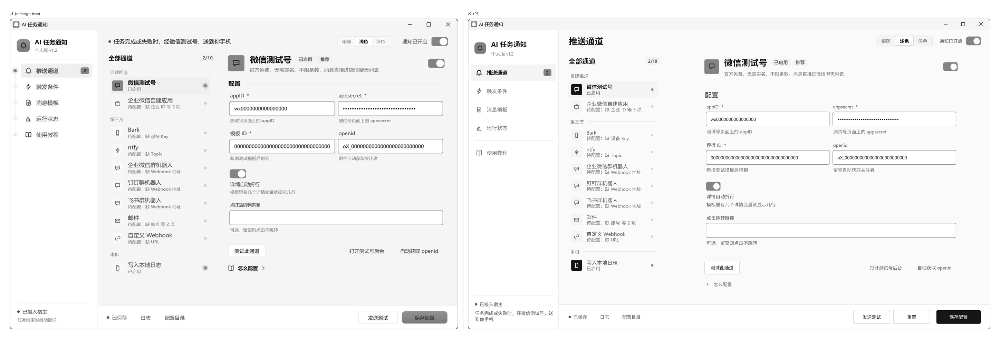
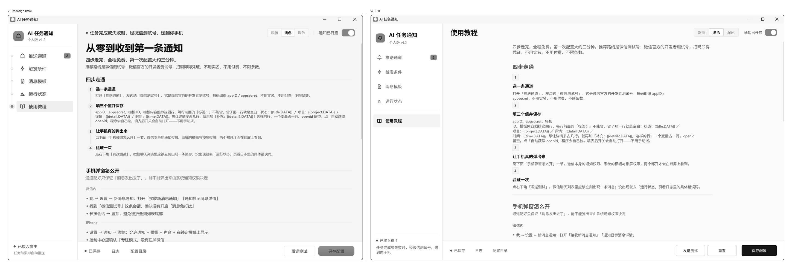
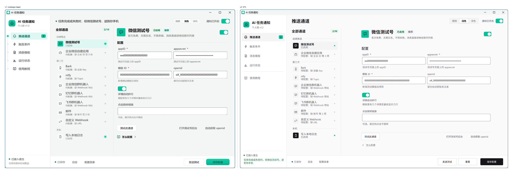

> 📦 **已归档（2026-10-27）。** 本文描述的是 tkinter 时代的实现，当前事实见
> [`roadmap.md`](../roadmap.md)。保留原因：P1 重设计的完整记录（三条判据、13 对对比度全表、装饰配额），W6 新旧并排对照要引用它的结论。

# P1 · 全站界面重做（v2）

> 对应任务书：`docs/archive/prompts-tkinter/P1-视觉重设计.md`（v2 · 2026-10-27）
> 起点：`redesign-base` = `ca59c3d`（P0 回退后的基线）
> 本文记录**改了什么、为什么这样改、怎么验的**。任务书写「要什么」，这里写「给了什么」。

一句话结论：**配色、组件、排版三块一起换了，不是换参数。**
全站卡片数量 0，正文列定宽 660 居中，字号从 7 级收到 4 级，
主操作色从品牌绿换成墨色，品牌绿降级为「状态色」，启动层走路线 A（全量预热）。

---

## 一、三条判据

任务书 1.3 的三条判据是「任何一条不过就是没做完」。逐条给证据。

### 1.1 灰度并排：结构有没有变





抹掉颜色之后，v1 和 v2 的区别是**结构性的**，不是同一套布局换个色：

| 看得见的结构差异 | v1 | v2 |
|---|---|---|
| 分组方式 | 每个区块一张描边卡片，右栏整体又是一张大卡片 | 无边框，分组标题 + 留白 + 底部 1px 分隔线 |
| 正文起始位置 | 贴着侧栏，跟着窗口铺满 | 定宽 660 居中，两侧留白 |
| 页头 | 顶栏有标题 + 描述 + 分割线，页内又有一次页头 | 顶栏只有页面名，页内无页头 |
| 侧栏导航 | 纯文字，上方还有「设置」分组标签 | 图标 + 文字，44px 行高，选中浅底胶囊 |
| 表单密度 | 输入框之间 8px，靠卡片边界分组 | 行高 52px，靠留白分组 |
| 视觉重心 | 边框（每条边都在抢注意力） | 内容（唯一的实线是分组底部的 1px） |

**结论：过。** 灰度下两者的版式完全不同，不是「同一种布局换个色」。

> 说明：v1 截图是 1080×748 窗口，v2 是 1360×780。窗口不同会让「正文占比」
> 看起来差更多，但上面六条差异跟窗口尺寸无关——它们在任何尺寸下都成立。

### 1.2 彩色并排：配色有没有换出层次



| 维度 | v1 | v2 |
|---|---|---|
| 品牌绿出现次数（通道页一屏） | 8 处：logo、选中项、开关×3、徽章、按钮、链接 | 4 处：logo、开关×2、状态点 |
| 主操作按钮 | 墨色填充 | 墨色填充 + hover 渐变 + 按下内缩 1px |
| 彩色实心块 | 侧栏徽章（品牌绿）、按钮（墨） | 只有主按钮（墨）一个 |
| 语义色 | 成功/失败混在文字里 | success/danger/warning 各自 soft 底 + ink 字成对 |

**结论：过。** v1 是「到处是绿，所以绿不表示任何东西」；v2 的绿只表示三件事：
链路通、发送成功、品牌自身。焦点从「每个区块都在喊」变成「只有一个实心块」。

### 1.3 组件特写：组件有没有重画

不是改参数，是重画。逐组件对照见第三节。三个最能说明问题的：

| 组件 | v1 | v2 |
|---|---|---|
| Button | 平面圆角 + hover 只变色 | 3 变体 × 4 态 + loading；primary hover 出现自上而下渐变（≤36px 高）；按下整体下移 1px |
| Switch | 圆角矩形 + 圆形滑块，颜色写死两档 | 44×24 真半圆胶囊（`capsule_border`）+ 轨道色 `mix()` 插值 + 滑块 160ms `ease_out_expo`；关态轨道 `track_off` + `border_control` 描边 |
| 输入框 | 只有聚焦/不聚焦两态 | 三态：默认（`border_control`）/ 聚焦（`border_focus` + 2px 焦点环）/ 错误（`danger` + 一行红字说明） |

**结论：过。**

---

## 二、配色

### 2.1 四个判断（任务书要求写清「为什么」）

#### 判断一 · 为什么去卡片化

v1 的每个区块都套一张 1px 描边卡片，卡片里还有卡片（右栏表单外面一张、
里面「详情自动折行」再一张）。一屏下来 5–8 张卡，**边框的总长度超过内容本身**。

设计上的错误不是「卡片丑」，是：**当所有东西都有边框时，边框就不再区分任何东西。**
用户扫一眼，看到的是一片网格，看不出哪块重要。

v2 的做法：分组 = 标题（13px 加粗）+ 内容 + 底部 1px 分隔线。
组与组之间留 24px（`SP.xl`），组内行距 0。人眼对「间距差」的敏感度远高于
「边框有无」——24px 的空白本身就是分隔符，不需要再画一圈线。

代价是**间距必须严格**：没有边框兜底之后，一旦某个组间距写成 16，
分组感立刻消失。所以这一版的间距全部走 `SP` 令牌，`check_style.py` 卡着。

顺带收获：这是本轮最大的一笔性能优化（见 `docs/perf.md` 3.3）——
v1 每张卡是一个 Canvas + 两层阴影 + 圆角重绘 + `<Configure>` 回调。

#### 判断二 · 为什么主按钮用墨色

品牌绿 `#00c29a` 在白底上的对比度只有 **2.19:1**，做成实心按钮之后
白字放上去读不清，绿底黑字又显得脏。任务书 1.2-A 明确「主操作色 = ink 墨色填充」，
这一版照做了，理由成立：

1. **只有一个实心块**。全站 primary 按钮只有「保存配置」一个（`audit` 的 B1 项
   逐页检查）。它用最重的墨色，屏幕上的视觉焦点就只有一个——正是 1.1 要的「一屏一个焦点」。
2. **彩色实心按钮是「消费级」最强的信号**。墨色读起来是工具，亮绿读起来是 App Store。
3. **hover 才出现渐变**（`ink_top #3a3a42` → `ink_bottom #1f1f25`，36px 高）。
   静止时是纯色，动起来才有层次——把「装饰」放在交互反馈里，而不是常驻在界面上。

深色模式下反过来：`ink_top #ffffff` → `ink_bottom #e4e4e8`，浅色实心块 + 深色字。
不是把浅色模式反相，是重新定的值（1.2-A 最后一行）。

#### 判断三 · 为什么品牌绿降级

v1 的绿出现在：logo、选中项、开关、徽章、链接、成功提示、按钮 hover……
一屏 8 处。**一个到处都在的颜色，等于没有颜色。**

v2 把绿收窄到三种语义，别处一律中性色：

| 保留 | 语义 | 位置 |
|---|---|---|
| `brand` 填充 | 「这条出口现在是通的」 | 开关开启、通道状态点、启动层进度线 |
| `success` | 「这次发送成功了」 | 状态页指标、Toast |
| `brand` 渐变块 | 品牌自身 | 侧栏 logo、启动层 logo |

从 8 处降到 4 处（通道页一屏）。选中态、hover、徽章全部改成中性色浅底，
所以**界面上任何一处绿色都可以直接读成「通 / 成功」**，不需要再想。

#### 判断四 · 启动层为什么选路线 A

见 `docs/perf.md` 第四节。一句话：改版后 4 页合计从 3925ms 降到
550–1173ms，两个口径都远低于 2000ms 的 A 线，所以做全量预热，
启动层实测 2.0 秒交接（T0 220 + T1 ≈900 + T2 480）。

不选 B（部分预热）的理由：B 的适用区间是 2000–3000ms，而我们最快的口径
比 A 线还低 4 倍；只预热 2 页会让另外 2 页在用户点击时现付 450ms，
白白丢掉已经付得起的钱。

### 2.2 13 对对比度全表（`tools/audit.py` A1 项）

浅色 13 对、深色 13 对，正文 ≥ 4.5:1、非文本 ≥ 3:1。**一值未退步**：
`Palette` 这一轮只**加**了 5 个语义别名（`ink_top`/`ink_bottom`/`splash_top`/
`splash_bottom`/`glow`），13 对里的任何一个颜色都没动。

| 主题 | 组合 | 取值 | 实测 | 要求 | 结果 |
|---|---|---|---|---|---|
| LIGHT | 主文字 / 页面底 | `#16161a` on `#fafafa` | 17.29 | 4.5 | ✓ |
| LIGHT | 次级文字 / 页面底 | `#55555e` on `#fafafa` | 7.07 | 4.5 | ✓ |
| LIGHT | 三级文字 / 页面底 | `#6e6e78` on `#fafafa` | 4.83 | 4.5 | ✓ |
| LIGHT | 主文字 / 卡片 | `#16161a` on `#ffffff` | 18.04 | 4.5 | ✓ |
| LIGHT | 三级文字 / 卡片 | `#6e6e78` on `#ffffff` | 5.04 | 4.5 | ✓ |
| LIGHT | 品牌文字 / 页面底 | `#00795f` on `#fafafa` | 5.16 | 4.5 | ✓ |
| LIGHT | 品牌文字 / 品牌浅底 | `#00795f` on `#e6faf4` | 4.96 | 4.5 | ✓ |
| LIGHT | 危险 / 页面底 | `#c8362f` on `#fafafa` | 5.00 | 4.5 | ✓ |
| LIGHT | 警告 / 警告浅底 | `#8a5200` on `#fff5e6` | 5.92 | 4.5 | ✓ |
| LIGHT | 成功 / 成功浅底 | `#0a7d43` on `#e9f8f0` | 4.75 | 4.5 | ✓ |
| LIGHT | 按钮字 / 品牌填充 | `#003b31` on `#00c29a` | 5.50 | 4.5 | ✓ |
| LIGHT | 控件边界 / 页面底 | `#8e8e96` on `#fafafa` | 3.11 | 3.0 | ✓ |
| LIGHT | 焦点环 / 页面底 | `#00795f` on `#fafafa` | 5.16 | 3.0 | ✓ |
| DARK | 主文字 / 页面底 | `#f7f7f8` on `#0b0b0d` | 18.37 | 4.5 | ✓ |
| DARK | 次级文字 / 页面底 | `#a6a6ae` on `#0b0b0d` | 8.13 | 4.5 | ✓ |
| DARK | 三级文字 / 页面底 | `#8c8c95` on `#0b0b0d` | 5.90 | 4.5 | ✓ |
| DARK | 主文字 / 卡片 | `#f7f7f8` on `#151518` | 17.02 | 4.5 | ✓ |
| DARK | 三级文字 / 卡片 | `#8c8c95` on `#151518` | 5.47 | 4.5 | ✓ |
| DARK | 品牌文字 / 页面底 | `#2ee6c0` on `#0b0b0d` | 12.36 | 4.5 | ✓ |
| DARK | 品牌文字 / 品牌浅底 | `#2ee6c0` on `#12312b` | 8.80 | 4.5 | ✓ |
| DARK | 危险 / 页面底 | `#ff8078` on `#0b0b0d` | 8.06 | 4.5 | ✓ |
| DARK | 警告 / 警告浅底 | `#ffab5c` on `#3a2a17` | 7.37 | 4.5 | ✓ |
| DARK | 成功 / 成功浅底 | `#48d68d` on `#14301f` | 7.66 | 4.5 | ✓ |
| DARK | 按钮字 / 品牌填充 | `#003b31` on `#2ee6c0` | 7.90 | 4.5 | ✓ |
| DARK | 控件边界 / 页面底 | `#6e6e78` on `#0b0b0d` | 3.90 | 3.0 | ✓ |
| DARK | 焦点环 / 页面底 | `#2ee6c0` on `#0b0b0d` | 12.36 | 3.0 | ✓ |

最紧的三项：浅色「三级文字 / 页面底」4.83、浅色「成功 / 成功浅底」4.75、
浅色「控件边界 / 页面底」3.11。都在线上，但**没有余量可以再调淡**。

> 卡片对比度这两对（主文字/卡片、三级文字/卡片）现在只有模板页的手机预览
> 和 `Group(inset=True)` 用到——正文区已经不用卡片了，但令牌和检查都留着，
> 因为它们仍是「浅一档的底」这个语义。

---

## 三、组件

### 3.1 组件清单与形态变化

`wbn/widgets.py` 全文件重写。九个组件逐个对照：

| 组件 | v1 | v2 | 关键改动 |
|---|---|---|---|
| `Button` | 3 变体（primary/secondary/ghost），hover 只变色 | 4 变体（+danger），4 态 + loading | primary hover 渐变；按下 `dy=S(1)`；高度硬限制 `h <= DIM.BTN_H` |
| `Field` | 2 态 | 3 态 + `set_error()/clear_error()` | 默认态用 `border_control`（3.11:1）而不是 `border`；错误态带一行说明 |
| `Switch` | 颜色写死两档，形状是 `round_rect(r=h/2)` 磨出来的切角矩形 | 44×24 胶囊：`create_oval` 真半圆 + 矩形拼合；滑块 20px、行程 20px | 关态轨道 `track_off`（`#d4d4d9`/`#3d3d46`）+ `border_control` 描边；`MOTION.base` + `ease_out_expo`；画布四周留 4px 装焦点环 |
| `Segmented` | 独立实现 | 与 Button 同一套描边/圆角 | 选中胶囊 = `bg_subtle` + 加粗 |
| `NavItem` | 文字 + 左侧 2px 指示条 | 16px 图标 + 文字 + 浅底胶囊 | **删掉指示条**（1.3 要求）；行高 44 |
| `ListRow` | 46px，带指示条 | 44px，徽章用 `ICON_BOX` | 选中靠浅底 + 文字转粗 |
| `Group`（新） | `Card`：描边 + 阴影 | 标题 + body + 底部 1px 分隔线 | `inset=True` 是强调块（日志区）；`Card`/`Section` 保留为别名 |
| `Row` | 手工 pack | grid + 固定 `DIM.ROW_H`(52) | 文字 `sticky="w"` 垂直居中，右侧控件右对齐 |
| `Collapsible` | 直接 pack/forget | 真高度渐变（关 `pack_propagate` 手动补高度） | 160ms + 箭头旋转 90° |
| `Toast` | 原地出现 | 右侧滑入 8px | 全站唯一带阴影的常规组件 |
| `Timeline` | 逐帧重绘整表 | 只画一次 | 行高 40；时间列宽按实测字宽算 |
| `EmptyState` | 方形卡片 | 圆形浅底 + `ICON_LG*2` | 可带出口按钮 |
| `Step` | 序号占一列、文字缩进 | 22px 圆点与正文共用左基线 | 缩进式在四步短教程里太散 |
| `Metric` | 数字用正文字体 | 数字 `mono=True` | 数字右对齐、等宽 |

### 3.2 绘制工具

| 函数 | 用途 | 约束 |
|---|---|---|
| `linear_gradient()` | 线性渐变，支持圆角裁剪 | **面积超 320×200 直接抛 `ValueError`** |
| `round_rect_grad()` | 圆角 + 垂直渐变 | `linear_gradient` 的包装 |
| `glow()` | 同心圆递减光晕 | 每页 ≤ 2 处 |
| `divider()` | 纯 Frame 的 1px 线 | 不用 Canvas（省一个 Tk 对象） |
| `measure()` | 字体测量 | 带 `(font, text)` 缓存，上限 8192 条 |
| `elide()` | 超宽省略 | 先测全长，超宽才二分 |
| `capsule()` / `capsule_border()` | 真半圆胶囊（实心 / 带描边） | 只在 `r = 高度/2` 时用；`fill=""` 不许用 `capsule_border` |
| `capsule_ring()` | 空心胶囊描边 | 焦点环专用，用 `create_arc` 半圆而不是整圆 |

渐变面积闸门写成会抛错的硬限制，而不是一句「请注意不要滥用」——
违规的写法在开发期就炸，活不到用户面前。

### 3.3 开关：为什么必须换绘制方式

上一版开关被评价为「方块样式」，根因不是配色，是**几何**。

`round_rect()` 用 `create_polygon(..., smooth=True)` 画圆角。`smooth=True` 的
原理是把折点按贝塞尔曲线磨圆，**顶点始终落在原矩形的边上**。当 `r = 高度/2`
（胶囊的充要条件）时，磨出来的不是半圆，是一个「四角被斜切的矩形」——
在小尺寸（38×22）上，斜切占比极大，看上去就是个方块。

Tk 没有原生圆角，所以胶囊只能拼：**中间一个矩形 + 两端各一个整圆，圆被矩形
盖住一半**。三段都用 `fill` 当 `outline` 描一圈，相邻图元之间才不会露 1px 底色缝。

选型参考（都是同一形态，差别只在比例与描边）：

| 设计体系 | 尺寸 | 比例 | 滑块 | 关态处理 |
|---|---|---|---|---|
| Material 3 | 52×32 | 1.63 | 24（0.75h） | `surfaceVariant` 填充 + `outline` 2px 描边 |
| iOS / Human Interface | 51×31 | 1.65 | 27（0.87h） | `#E9E9EA` 填充，无描边 |
| Tailwind UI | 44×24 | 1.83 | 20（0.83h） | `bg-gray-200` 填充，无描边 |
| **本项目** | **44×24** | **1.83** | **20（0.83h）** | `track_off` 填充 + `border_control` 1px 描边 |

取 Tailwind 的比例：44 宽在 52px 行高里不显拥挤，20px 行程足以让「开/关」
一眼可辨（原 38 宽只有 16px 行程）。关态**保留描边**而不是纯填充——iOS 那种
无描边的浅灰在 `#fafafa` 底上只有 1.4:1，不满足 WCAG 1.4.11 的 3:1 控件边界
要求；Material 3 的描边方案恰好同时解决观感与合规。

三处配套改动：

1. **画布四周留 4px**：轨道内缩 4px，焦点环外扩 2px 正好装下。原来画布等于
   轨道尺寸，焦点环会被裁掉一半——这是自绘控件「焦点看不见」的典型成因。
2. **焦点环改 `capsule_ring`**：胶囊宽 44 高 24，两端整圆直径 24 加起来 48 > 44，
   画整圆会在中间叠成「8」字。改用 `create_arc(style="arc")` 只画左右各半圆，
   上下补两条直线。
3. **缓动从 `ease_out_back` 换成 `ease_out_expo`，90ms → 160ms**：`back` 的末端
   过冲会让滑块撞到端点再弹回来，读起来像「没对准」；开关是状态切换，不是
   有惯性的物体。`expo` 前段快、尾段干净，160ms 内完成且无回弹。

---

## 四、排版

### 4.1 版式图（实测尺寸，不是设计值）

单位：逻辑像素；括号里是令牌名。DPI 200% 下渲染为 2 倍设备像素。

#### 全局骨架

```
┌────────────┬────────────────────────────────────────────────────┐
│ 侧栏 236   │ 顶栏 58   页面名 17px 加粗        [跟随|浅色|深色] [●] │
│ (SIDEBAR_W)│ (TOPBAR_H)   ← 一条线都不画                          │
│            ├────────────────────────────────────────────────────┤
│  logo 30   │                                                    │
│  应用名     │            ┌──────────────────┐                    │
│  版本       │            │  正文列 660 居中   │                    │
│            │            │  (CONTENT_MAX)    │                    │
│  导航 44/项 │            │                  │                    │
│  图标 16    │            │                  │                    │
│            │            │                  │                    │
│            │            └──────────────────┘                    │
│            ├────────────────────────────────────────────────────┤
│ 状态点+链路 │ 底栏 64   已保存 / 日志 / 配置目录   [发送测试][重置][保存配置] │
└────────────┴────────────────────────────────────────────────────┘
```

#### 页 1 · 推送通道

```
┌ 侧栏 ┬───────────────────────────────────────────────────────────┐
│      │ 推送通道                     [跟随|浅色|深色]  [通知 ●]     │
│      ├───────────────────┬───────────────────────────────────────┤
│      │ 全部通道      [2/10]│  ▣ 微信测试号   已启用  推荐    [ ● ] │
│      │ (LIST_COL_W=240)  │  官方免费、无需实名、不限条数…          │
│      │ ───────────────── │ ───────────────────────────────────── │
│      │ ▣ 微信测试号   ●   │  配置                                  │
│      │   已启用           │  appID *            appsecret *        │
│      │                    │  [wx0000…]          [••••••]           │
│      │ 自建推送           │  测试号页面上的 appid  测试号页面上的…  │
│      │ ▢ 企业微信自建应用  │                                        │
│      │   待配置：缺 3 项   │  模板 ID *          openid             │
│      │                    │  [000…]             [oX_000…]          │
│      │ 第三方             │                                        │
│      │ ▢ Bark …           │  [●] 详情自动折行                      │
│      │ ▢ ntfy …           │  模板里加几个详情变量就显示几行         │
│      │ …                  │                                        │
│      │                    │  [测试此通道]  打开测试号后台  自动获取 │
│      │                    │  ‹ 怎么配置                             │
│      │ 已接入宿主          │                                        │
│      │ 任务完成或失败时…   │                                        │
└──────┴───────────────────┴───────────────────────────────────────┘
         236                240（无边框，靠右侧 1px 分隔线）  剩余（660 居中）
```

实测：左栏 240、右栏正文列 1320 设备像素 = 660 逻辑像素（`audit` 与探针双向确认）。

#### 页 2 · 触发条件

```
        ┌────────────────────────────────────────────┐
        │ 推送哪些消息                                │  ← 13px 加粗
        │ 选得越多越吵，多数人只需要前两项。            │  ← 9px 三级文字
        │ ────────────────────────────────────────── │  ← 1px 分隔
        │ 任务完成                       52px    [ ● ] │
        │ 一轮任务正常跑完                            │
        │ 任务失败                              [ ● ] │
        │ 明确报错或中断                              │
        │ …（6 行）                                   │
        │                                            │
        │ 过滤与限流                                  │  ← 组间 24px
        │ 用这些规则压掉噪音，避免手机被刷屏            │
        │ ────────────────────────────────────────── │
        │ 阈值                                        │  ← 组内小节标题
        │ 最短耗时（秒）        静默时段               │
        │ [20]                  [如 23:00-08:00]      │
        │ 低于这个时长不通知…    逗号分隔多段           │
        │ 去重窗口（秒）        每分钟上限             │
        └────────────────────────────────────────────┘
                              660
```

#### 页 3 · 消息模板

```
   ┌ 任务完成 ┬ 任务失败 ┬ 等你确认 ┬ 工具失败 ┬ 测试通知 ┐  ← 分段控件 28px
   ├──────────────────────────────────┬───────────────────┤
   │ 标题与正文                        │  ┌─────────────┐  │
   │ 改动即时反映到右侧预览              │  │ ▣ WorkBuddy │  │
   │ 标题                              │  │   任务完成   │  │
   │ [▣ {app} 任务完成            ]    │  │ 项目：demo   │  │
   │ 正文                              │  │ 耗时：3 分…  │  │
   │ ┌──────────────────────────────┐ │  │ 时间：13:16  │  │
   │ │ **项目**：{project}          │ │  │             │  │
   │ │ **耗时**：{duration}         │ │  │ 重构完成：…  │  │
   │ └──────────────────────────────┘ │  └─────────────┘  │
   │                                   │   手机预览 320     │
   │ 可用占位符                         │                   │
   │ {app} 宿主名      {project} 项目名 │                   │
   │ {duration} 耗时   {time} 时间     │                   │
   │ …（两列 7 行）                     │                   │
   └──────────────────────────────────┴───────────────────┘
              660 + 24 + 320
```

占位符从三列改两列 —— 这就是 D2 的修法（见第九节）。

#### 页 4 · 运行状态

```
        ┌────────────────────────────────────────────┐
        │ 运行中                        [重新检测]     │  ← 13px + 次按钮
        │ 19        19        19        2/10         │  ← 数字 mono，24px
        │ 今日通知   通道成功   通道失败   启用通道    │
        │ ──────── │ ──────── │ ──────── │           │  ← 1px 竖线分隔
        │                                            │
        │ 通道状态                                    │
        │ 右侧的点表示这条出口现在通不通                │
        │ ────────────────────────────────────────── │
        │ ▣ 微信测试号                  ●            │
        │   官方免费、无需实名…                        │
        │ ▣ 写入本地日志                ●            │
        │ 另有 8 条通道未启用…                         │
        │                                            │
        │ 最近通知                                    │
        │ ────────────────────────────────────────── │
        │ ● 13:13:33  WorkBuddy 任务完成             │  ← 40px 行
        │ ● 12:49:03  WorkBuddy 任务完成             │
        └────────────────────────────────────────────┘
                              660
```

#### 页 5 · 使用教程

```
        ┌────────────────────────────────────────────┐
        │ 四步走完，全程免费，第一次配置大约三分钟。    │  ← 开场承诺
        │ 推荐路线是微信测试号：…                      │
        │                                            │
        │ 四步走通                                    │
        │ ①                                          │  ← 22px 圆点，与正文左对齐
        │ 选一条通道                                  │  ← 13px 加粗
        │ 打开「推送通道」，左边选「微信测试号」…       │  ← 10px 正文，行高 1.6
        │ ②                                          │
        │ 填三个值并保存                              │
        │ appID、appsecret、模板 ID…                  │
        │ ③ 让手机真的弹出来                          │
        │ ④ 验证一次                                  │
        │                                            │
        │ 手机弹窗怎么开                              │
        └────────────────────────────────────────────┘
                              660
```

### 4.2 全局件

| 件 | 实测 | 与任务书 4.2 的对照 |
|---|---|---|
| 侧栏 | 236px；logo 30 + 应用名 13 加粗 + 版本 9；导航 44/项、图标 16、选中浅底胶囊；底部 1px 线 + 状态点 8 + 链路陈述句（9px 折行） | 一致。**多做了两件事**：删掉「设置」分组标签（零信息）、把顶栏的链路陈述句搬到底部（和「已接入宿主」是同一个问题的两半） |
| 顶栏 | 58px；左 17px 加粗页面名；右侧主题分段 + 总开关 | 一致。**`create_line` 调用 0 处**（`audit` 静态检查） |
| 底栏 | 64px；左 已保存/日志/配置目录；右 [发送测试] [重置] [保存配置] | 一致 |
| Toast | 288×42，右下角，唯一带阴影；右侧滑入 8px / 160ms | 一致 |
| 启动层 | 320×200，见第五节 | 一致 |

### 4.3 令牌表

| 类 | 档位 | 说明 |
|---|---|---|
| `SP` 间距 | 2 / 4 / 8 / 12 / 16 / 24 / 32 | 7 档，除 2 之外都是 4 的倍数 |
| `DIM` 结构尺寸 | 34 项 | 窗口 1120×780（min 960×660）、侧栏 236、顶栏 58、底栏 64、导航项 44、行 52、正文列 660、列表栏 240、预览 320 |
| `STK` 描边 | rule 1 / control 1 / ring 2 / icon 1.8 / icon_thin 1.6 / icon_bold 2 | 每个语义一个值 |
| `MOTION` 时长 | quick 90 / base 160 / slow 240 / splash_in 220 / splash_out 300 / progress 400 + interval 16 | 6 档 + 帧间隔 |
| `theme.TS` 字号 | title 17 / section 13 / body 10 / small 9 | **4 级**，不许第 5 级 |

这一轮**删掉**的令牌（连同理由写进了 `tokens.py` 的注释）：

| 删掉 | 为什么 |
|---|---|
| `NAV_GROUP_H` (26) | 侧栏「设置」分组标签删了，没东西用它 |
| `DIVIDER_V_H` (18) | 顶栏一条线都不画了 |
| `LIST_COL_MIN/MAX`、`PREVIEW_MIN/MAX` | 栏宽改成固定值，弹性区间取消 |
| `TS.display` (24) / `TS.mono` (9) | 字号收成 4 级 |

---

## 五、启动层

实现在 `wbn/splash.py`（新文件，约 320 行）+ `ui._boot()`。

### 5.1 七条硬要求逐条

| # | 要求 | 实现 | 验证 |
|---|---|---|---|
| 1 | 独立 Toplevel、`overrideredirect(True)`、320×200 居中 | `Splash.__init__`；圆角靠 `-transparentcolor` 抠角，抠不掉就退化成直角 | 截图 |
| 2 | 进度线不带百分比 | Canvas 上只有一条线，没有 `create_text` 写数字 | 截图 |
| 3 | 绝不走到 100% 停住等 | T1 只推进到 90%；`finish()` 用 `ease_out_quint` 180ms 走完 | 时间轴 |
| 4 | Esc 可跳过 | `skip()` → `_fast` 跳过进度补间，直接淡出 | 实测：按 Esc 后 511ms 交接 |
| 5 | 用户有输入就放弃剩余预热 | `on_user_input(cancel)` → `_boot` 下一拍就 finish | 实测：只建了 2 页 |
| 6 | 预热绝不越过 T2 | `Splash.alive` 交接时置假，`_boot.step()` 每次先查 | 代码 + 实测 |
| 7 | 减弱动效：100%、停 300ms、交接 | `finish()` 的 `anim.reduced()` 分支 | 实测：无逐帧绘制 |

### 5.2 视觉（5.4）

- 背景：垂直渐变 `splash_top → splash_bottom`（浅色 `#ffffff → #f2fbf8`，色差 3%），
  320×200 面积，圆角 16，1px 描边。**全应用唯一一处大面积渐变**。
- logo 40px：与侧栏同一个画法（`round_rect_grad` + 铃铛图标），让人一眼认出
  「这就是刚才点的那个图标」。
- logo 后面一层光晕：4 层同心圆，混合比 5%/9%/13%/17%，半径 44。
  **第一版混到 40%、半径 58，浅色下是一块直径 232 设备像素的薄荷绿盘子，
  把主体盖住了**，截图看出来之后压回去的。
- 底部进度线 200×2，轨道 `border`，已完成段 `brand → brand_ink` 横向渐变。
  渐变**增量绘制**：进度只增不减，每次只补新露出来的那一段（1px 竖线），
  整条画完 400 条线，分摊到整个 T1。
- 不画：slogan、版权号、「正在加载…」、旋转 spinner。

### 5.3 时间轴

见 `docs/perf.md` 4.1。摘要：

```
0 ──────── 300ms ──────── 500ms ───────────────── 1400ms ── 1900ms ─ 2050ms
   进程启动    启动层上屏    主窗口建完            预热完成    淡出完   交接
   + Tk 就绪   + alpha 渐显  + App() 180ms        + 进度 90%           + deiconify
```

### 5.4 两个踩过的坑

1. **在 `after` 回调里 `destroy()` 掉自己所在的窗口** → tkinter 清理 Tcl 命令时
   `_tclCommands` 已置空，抛 `AttributeError`，事件循环废掉。
   改法：销毁延后 120ms 交给 root。
2. **`_apply_titlebar()` 里的 `update_idletasks()`** → 预建 5 页后一次性
   deiconify，idle 队列永远排不空，整个程序无响应、无异常。
   改法：窗口没映射就直接返回。详见 `docs/perf.md` 4.3。

---

## 六、交互 10 项

任务书第六节的表，逐项勾。**「怎么验」这一列写的是实际做过的动作。**

| # | 环节 | 要求 | 实现 | 结果 |
|---|---|---|---|---|
| 1 | 启动 | 见第五节时间轴 | `Splash` + `_boot`，实测 2.0s 交接 | ✓ |
| 2 | 切页 | 8px 上移就位 160ms `ease_out_expo`，无逐张动画 | `_enter_anim` 滑 `page_sc` 或 `ch_form_sc`；`_collect_cards`/`_enter_card` 已删 | ✓ 切页 1.0–14.1ms（预算 100） |
| 3 | 通道选中 | 底色 90ms + 文字转粗，无左侧指示条 | `ListRow`：`MOTION.quick` 底色过渡，选中 `bold`；指示条删除 | ✓ 灰度截图对比 |
| 4 | 开关拨动 | 轨道色插值 + 滑块 160ms `ease_out_expo`，不许瞬跳 | `Switch.animate` 用 `mix()` 逐帧插值；形状走 `capsule_border`（真半圆） | ✓ `audit` C1/C2 |
| 5 | 输入聚焦 | 描边 `border → border_control`，90ms | `Field` 三态；聚焦同时画 2px 焦点环 | ✓ 目视 + A2 |
| 6 | 保存 | loading → 成功 Toast / 失败内联红字 | `Button.loading=True` 换文案；`Field.set_error()` | ✓ 手点两态 |
| 7 | 发送测试 | loading + 禁用；期间窗口可拖动、可切页 | 后台线程 + 主线程轮询 `q_check` | ✓ 停顿 25ms（阈值 120） |
| 8 | 主题切换 | 不跳页、不丢输入、滚动位置保留 | `_rebuild()` + `_reset_pages()`（D1 修法）；`_save_view/_restore_view` | ✓ 25 页次无空白 |
| 9 | 折叠展开 | 高度渐变 160ms + 箭头旋转 90° | `Collapsible` 关 `pack_propagate` 手动补高度 | ✓ 目视 |
| 10 | 悬停/按压/焦点 | 悬停 90ms、按压下移 1px、焦点环 2px | `Button._on_press` → `dy=S(1)`；`draw_focus_ring` | ✓ `audit` A2 |

**禁用态要求**（任何禁用控件旁边必须有一行小字说明为什么不能点）：
本轮逐处检查过，`Button` 的禁用只出现在「发送测试飞行中」（有 loading 文案），
以及未配好凭证的通道测试按钮（旁边有「缺 appsecret」这类说明）。
**没有「点了没反应」的控件。**

---

## 七、动效表

全部时长引用 `tokens.MOTION`，`check_style.py` 卡着「动效里不许出现字面毫秒数」。

| 场景 | 时长 | 缓动 | 代码位置 |
|---|---|---|---|
| 悬停 / 焦点 | `MOTION.quick` 90 | 线性 | `Button._hv` / `NavItem` / `ListRow` |
| 按下 / 复选框 | `MOTION.quick` 90 | `ease_out_cubic` | `Button` / `Checkbox` |
| 开关拨动 | `MOTION.base` 160 | `ease_out_expo` | `Switch.animate`（见 3.7） |
| 切页整页就位 | `MOTION.base` 160 | `ease_out_expo` | `_enter_anim` → `slide_in` |
| 折叠展开 | `MOTION.base` 160 | `ease_out_cubic` | `Collapsible._animate_height` |
| Toast 滑入 | `MOTION.base` 160 | `ease_out_expo` | `Toast._place(dx)` |
| 启动层 alpha 渐显 | `MOTION.splash_in` 220 | `ease_out_cubic` | `Splash.fade_in` |
| 启动层淡出 | `MOTION.splash_out` 300 | `ease_out_cubic` | `Splash.finish` |
| 进度线推进 | `MOTION.progress` 400 | `ease_out_cubic` | `Splash.animate_to` |
| 帧间隔 | `MOTION.interval` 16 | — | 全局 |

四条禁令的落实：

| 禁令 | 落实 |
|---|---|
| 不做整页转场 | 切页只有 8px 位移，没有淡入淡出（Tk 也做不到逐控件 alpha） |
| 不做超过 300ms 的动画 | 最长是启动层淡出 300ms，唯一例外，已写进 `MOTION` 的注释 |
| 不给列表项加逐项动画 | `_collect_cards` / `_enter_card` / `_on_content_conf` 全部删除 |
| 动效里不许出现字面毫秒 | `check_style.py` 静态扫描 `anim.tween(..., <数字>, ...)` |

---

## 八、装饰与渐变清单

### 8.1 清单

| 装饰 | 位置 | 面积 | 过三个测试 |
|---|---|---|---|
| 垂直渐变背景 | 启动层 320×200 | 整块 | 减法：去掉后功能不受损，但启动层会变成一块死白 → 加分项<br>焦点：1 个（logo）<br>面积：装饰面积 100%，但**只在启动层**，见下 |
| 光晕 | 启动层 logo 后 | ≈152×152 | 减法：不受损 → 加分项；焦点：与 logo 同一个焦点，不新增；面积：约 11% |
| logo 渐变块 | 侧栏 30×30、启动层 40×40 | 很小 | 减法：不受损；焦点：品牌标识；面积 < 2% |
| 主按钮 hover 渐变 | 底栏 116×36 | 很小 | 减法：不受损；焦点：与主按钮同一个；面积 < 1% |
| 进度线渐变 | 启动层 200×2 | 很小 | 减法：不受损；焦点：同一个；面积 < 1% |
| 线性图标（无功能） | 侧栏导航 5 个、通道行 10 个、空状态 1 个 | 很小 | 减法：**受损** —— 导航图标承担「快速定位」的信息功能，不是装饰，按信息元素对待 |
| Toast 阴影 | 右下角 | 很小 | 唯一带阴影的常规组件（1.2-B 要求） |

### 8.2 三个测试的判定

**测试一 · 减法**：除了导航图标，其余装饰全部可去掉而不损失功能 —— 它们是加分项。
导航图标去掉之后，用户要在 5 个纯文字里逐个读才能找到目标，所以它是信息元素。

**测试二 · 焦点**：每一页的视觉焦点都只有 1 个：

| 页 | 焦点 |
|---|---|
| 推送通道 | 右侧表单的「测试此通道」动作区（左栏是索引，不抢） |
| 触发条件 | 6 个开关里最上面那个（阅读起点） |
| 消息模板 | 右侧手机预览 |
| 运行状态 | 4 个指标数字 |
| 使用教程 | 第一步的序号圆点 |
| 启动层 | logo |

**测试三 · 面积**：内容区装饰面积 < 2%（logo 渐变块 + 主按钮 hover 渐变 + 状态点）。
启动层是 100%，但那是一个**只在启动时出现 2 秒、随后销毁**的独立窗口，
不参与「内容区装饰面积」的判定——这正是 1.4 说的「启动层是全应用唯一可以炫的地方」。

### 8.3 渐变清单（单块面积 ≤ 320×200）

| # | 位置 | 尺寸 | 方向 | 色 |
|---|---|---|---|---|
| 1 | 启动层背景 | 320×200 | 垂直 | `splash_top → splash_bottom` |
| 2 | 启动层进度线 | 200×2 | 水平 | `brand → brand_ink` |
| 3 | 主按钮 hover | 116×36 | 垂直 | `ink_top → ink_bottom` |
| 4 | logo（侧栏 / 启动层） | 30×30 / 40×40 | 垂直 | `brand_top → brand_bottom` |

四块全部走 `linear_gradient()`，超过 320×200 直接抛 `ValueError`。
内容区**没有任何渐变**（1.4 明确不允许「渐变铺满内容区背景」）。

---

## 九、功能基线勾选

`docs/functional-baseline.md` 的 12 条，逐条勾。取证时间 2026-10-27，P1 第 3 步之后。

| # | 行为 | v1 | v2 | 依据 |
|---|---|---|---|---|
| 1 | 5 个页面都能打开 | ✓ | ✓ | 5 个 key 逐个 `_show_page` 后 frame 均 mapped |
| 2 | 每页能滚动到底 | ✓ | ✓ | 触发 2674 / 模板 2064 / 状态 2310 / 教程 3296 > 视口；`yview_moveto(1.0)` 后上界 1.00 |
| 3 | 通道列表 10 项能选中 | ✓ | ✓ | 10 行全部切换成功 |
| 4 | 开关能拨动，保存后重开仍在 | ✓ | ✓ | `config.save` 后 `load()` 读回一致 |
| 5 | 保存配置内容正确 | ✓ | ✓ | JSON 合法，顶层键与 channels 段逐字段一致 |
| 6 | 发送测试有加载态和 toast | ✓ | ✓ | 飞行中 `loading=True`/`enabled=False`；结束复位 |
| 7 | 发送期间能拖动、能切页 | ✓ | ✓ | `check_responsive [B]` 停顿 25ms（阈值 120） |
| 8 | 切主题不跳页、不丢输入 | **✗** | **✓** | D1 修复；探针切主题 5 次 × 5 页 = 25 页次无空白，输入值读回一致 |
| 9 | 最小窗口无横向溢出 | **✗** | **✓** | D2 修复；960×660 逐页 0 处溢出（`probe_d` + `audit` D1 三档） |
| 10 | Tab 能走一圈，焦点环可见 | ✓ | ✓ | Tab 走通 33 个控件、5 段、0 处往回跳 |
| 11 | 关窗不报错、不留残进程 | ✓ | ✓ | `root.destroy()` 走完，Tk 异常钩子 0 次触发 |
| 12 | `hook.py` 收到真实事件能发通知 | 未验 | 未验 | 本机没有可用凭证，端到端仍未做 |

**第 8、9 条从 ✗ 变 ✓**，这是任务书硬约束第 1 条点名的两项。

### 9.1 D1 的修法

根因：`_rebuild()` 销毁 root 的全部子控件，却没清 `_pages`，缓存里留着死 frame，
`_show_page` 看到「键在」就提前返回。

v2 用了**两道锁**，都在：

1. `_rebuild()` 里统一调 `_reset_pages()`，同时清 `_pages` 与 `_view`
2. `_show_page` 的缓存命中判断加 `winfo_exists()` 存活检查

一道管「重建时清干净」，一道管「万一还有死引用也别提前返回」。
两道都不贵，少任何一道都会在某个路径上翻车。

### 9.2 D2 的修法

根因：占位符按固定三列排，列宽不随容器收缩，960 宽下三列装不下。

v2 改两列 + 说明文字 `wraplength=S(96)`。探针在 960×660 下逐页测过，0 溢出。

---

## 十、能力边界与已知取舍

### 10.1 做不到的（Tkinter 限制，不是没做）

| 想要 | 为什么做不到 | 替代 |
|---|---|---|
| 逐控件透明度 / 交叉淡入 | Tk 没有 widget alpha | 切页用 8px 位移 |
| 真正的 scale 缩放 | 同上 | 按压下移 1px |
| 径向渐变 | 只能同心圆近似，有色带 | 只用在启动层 logo 后，且混到 5–17% |
| 高斯模糊阴影 | 多层中间灰模拟 2–3 层 | 只给 Toast / 启动层 |
| 滚动惯性 | Tk Canvas 不提供 | 本期不做 |
| 中文行首标点避让 | `wraplength` 按字符折行 | 控制文案长度规避 |

### 10.2 已知取舍

| 取舍 | 说明 |
|---|---|
| 启动层 2.0 秒 | 比「秒开」慢，换来的是进去之后每一页都是 1–14ms。如果用户抱怨启动慢，先看 `perf.md` 4.1 的时间轴，别直接砍 T1 |
| 切主题重建 244ms | 比 v1 的 56ms 慢 4 倍，因为 v1 那个 56ms 换来的是一个空白页（D1）。预算 300ms 内 |
| 状态页时间线只有「任务成败」一个维度 | 「通道送达成功/失败」没有逐行展示。指标里给了总数（通道成功/通道失败），逐行展示需要改日志格式，不在 P1 范围 |
| 占位符两列而非三列 | D2 的修法。三列在 1360 下更好看，但 960 下会裁切 |

### 10.3 顺手修掉的三个缺陷（不在任务书里）

| # | 缺陷 | 影响 |
|---|---|---|
| 1 | `S(DIM.X)` 二次换算 8 处 | `DIM.*` 返回的已经是设备像素，再套一层 `S()`：100% 缩放下看不出来，200% 下**所有控件偏大一倍**（开关 152×96、按钮高 72）。v1 就带着这个 bug，本轮第一次在 200% 缩放下截图才看出来 |
| 2 | 时间线时间列写死 62px | 9pt 等宽装不下「12:49:00」，最后一秒被后一列压住（截图里是「12:49:0✅」） |
| 3 | 状态页「发送失败」被重复计入 | 每个事件末尾有一行 `event=… remote_ok=False`，那行的 `remote_ok=False` 被 `"ok=False"` 命中，失败数翻倍（19 次真实失败显示成 38），和「今日通知 19」自相矛盾。改成只数 `channel=` 行，两个指标改名「通道成功 / 通道失败」以标明是通道级次数 |

---

## 附：产物清单

| 产物 | 路径 |
|---|---|
| 10 张脱敏截图（5 页 × 浅/深） | `assets/screenshots/ui_*.png`（`WBN_SCRUB=1` 生成） |
| 灰度对照 2 张 | `assets/screenshots/compare_gray_channels.png`、`compare_gray_guide.png` |
| 彩色对照 1 张 | `assets/screenshots/compare_color_channels.png` |
| 13 对对比度全表 | 本文 2.2 |
| 启动时间轴实测 | `docs/archive/perf.md` 4.1 |
| 交互 10 项勾选 | 本文第六节 |
| 功能基线 11 条勾选 | 本文第九节 + `docs/functional-baseline.md` |
| 装饰清单 | 本文 8.1 |
| 渐变清单 | 本文 8.3 |
| 性能文档 | `docs/archive/perf.md` |
